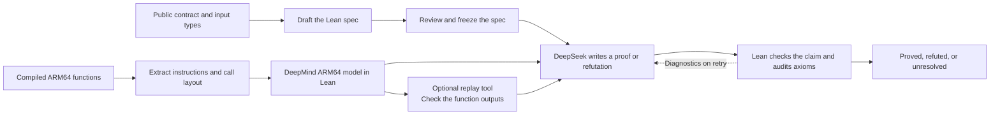

# Check compiled DP code with Lean

This research pilot asks whether an agent can prove a differential privacy library's sensitivity claim against its compiled code. The first case is a historical integer bounded-sum bug in OpenDP. We check the same claim against the instruction bytes from the buggy and fixed ARM64 builds.



Start with the [OpenDP case](cases/opendp-bounded-sum/README.md) for the bug, the input domain, and the connection between the extracted bytes and Lean.

## Try the pilot

Use an Apple Silicon Mac. Install Python 3.12 and [uv](https://docs.astral.sh/uv/). The pilot uses Lean 4.34.0 and a pinned revision of DeepMind's ARM64 model. Set `OPENDP_PILOT_CACHE` to the directory containing the toolchain and model checkout. The existing pilot cache defaults to `~/Library/Caches/lean-binary-dp-demo`.

```sh
uv venv --python 3.12
uv pip install -r requirements.txt
uv run --no-project python -m tests.smoke --out runs/offline
```

The smoke check uses a local model fixture. It exercises the same harness and Lean checker and verifies that they accept the fixed proof and the buggy-build refutation. It runs for several minutes. It needs no OpenRouter key.

### Run the agent on OpenRouter

Put `OPENROUTER_API_KEY` in an untracked `.env` file and load it into the terminal.

```sh
set -a
source ./.env
set +a
```

The checked-in [specification](cases/opendp-bounded-sum/Spec.lean) is the reviewed spec from the pilot. This command checks the fixed binary snapshot, candidate A, with the same DeepSeek 1017 model and an automatic retry.

```sh
uv run --no-project python -m dpverify --attempts 2 --max-tokens 32768 verify \
  cases/opendp-bounded-sum \
  --approve-spec c9bb4e8cf48219cbd2260a8e23971152e92841debd162154e4cb85a2a07cee36 \
  --candidate A --arm-replay --lean-profile --out runs/fixed
```

Omit `--candidate A` to check both snapshots. Use `--proof-model` after `verify` to try another model. For an OpenAI-compatible vLLM endpoint, pass `--endpoint` before the subcommand, set `DP_HARNESS_MODEL_KEY`, and use the model ID served by vLLM. Use `python -m dpverify draft runs/spec` to draft a new spec, review the resulting `Spec.lean`, and pass its approved hash to `verify`.

### Read the run

- `report.json` lists each candidate's verdict. A timeout or rejected proof yields `unresolved`.
- `experiment.json` records the model, token cap, limits, and file hashes.
- `A/Attempt*.lean` contains the submitted proofs with the harness's fixed wrapper. Adjacent logs contain Lean diagnostics and, with `--lean-profile`, declaration timings.
- `A/proof-*/` preserves prompts, responses, streamed SDK notifications, session events, usage, and replay tool calls.

The replay tool checks tables of machine outputs. DeepSeek writes the theorem that connects those outputs to the sensitivity claim. Lean accepts a verdict only after it checks the theorem and the harness audits its axioms.

## Repository layout

- [dpverify/](dpverify/) contains the workflow, DeepSeek Harness integration, and replay tool.
- [cases/opendp-bounded-sum/](cases/opendp-bounded-sum/) contains the frozen spec, extracted instruction snapshots, provenance, and the native rebuild recipe.
- [tests/smoke.py](tests/smoke.py) runs the workflow through the real SDK with a local fixture provider.

The check covers the two-record integer contract for the compiled closures and their recorded Rust call layout. It relies on the extractor, call layout, and ARM64 model. The contract does not establish end-to-end privacy for OpenDP or its noise mechanisms.
