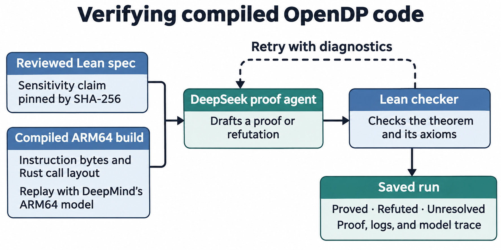

# Check compiled differential privacy code with Lean

This research pilot gives DeepSeek one Lean sensitivity claim and two compiled ARM64 builds of an OpenDP function. DeepSeek writes a proof or a refutation for each build, and Lean checks the result.

| Case | What Lean checks |
| --- | --- |
| [Bounded sum](cases/opendp-bounded-sum/README.md) | The compiled sum and its advertised bound on two-record inputs |
| [Integer overflow](cases/opendp-overflow/README.md) | The compiled sum on four inputs near the signed integer limit, using a bound checked by the native probe |

## How it works



The spec describes how much the sum may change between neighboring datasets. Review it once and use its SHA-256 to pin the same statement for both builds. The repo includes reviewed specs. The optional `draft` command asks a model to write a new one from a case brief.

Each case ships extracted instruction bytes and a handwritten Lean adapter that supplies inputs using the recorded Rust call layout. The harness uses DeepMind's ARM64 model to execute those bytes. It gives the proof agent either output hints or, for the bounded-sum case, a tool that returns equalities Lean has checked. The final theorem connects the compiled computation to the spec over the case's finite input domain. [Machine adapter](cases/opendp-bounded-sum/Machine.lean) · [Replay tool](dpverify/replay.py)

These checks cover sensitivity of the sum. End-to-end privacy also depends on the noise mechanism and how privacy losses compose.

## Set up and run offline

Use an Apple Silicon Mac with the Xcode Command Line Tools and uv. Run the commands from the repository root. Setup downloads Lean 4.34.0, verifies the release checksum and pinned DeepMind revision, and builds the ARM64 model. Both the smoke check and live runs use the checked-in instruction snapshots. [Install uv](https://docs.astral.sh/uv/getting-started/installation/)

```sh
uv sync --locked --python 3.12
uv run --locked python -m dpverify setup
uv run --locked python -m tests.smoke --out runs/offline
```

The smoke check uses a local fixture provider and takes several minutes. It exercises the real SDK and Lean checker, including a retry after Lean rejects an invalid theorem. The expected results are `A: proved` for the fix and `B: refuted` for the old build. The run report is at `runs/offline/proof/report.json`. An OpenRouter key is only needed for the live OpenRouter run.

The default toolchain cache is `~/Library/Caches/dp-binary-verification`. If you set `DPVERIFY_CACHE`, use the same absolute directory for setup and subsequent runs. Pick a fresh output directory each time to preserve the previous run.

## Run the agent on OpenRouter

Set `OPENROUTER_API_KEY` in the shell. If you keep it in an ignored `.env` file at the repository root, load it with these commands.

```sh
set -a
source ./.env
set +a
```

This command checks candidate A for the bounded-sum case using the reviewed spec and the optional ARM replay tool. [Reviewed spec](cases/opendp-bounded-sum/Spec.lean)

```sh
uv run --locked python -m dpverify --case opendp-bounded-sum --attempts 2 --max-tokens 32768 verify \
  cases/opendp-bounded-sum \
  --approve-spec c9bb4e8cf48219cbd2260a8e23971152e92841debd162154e4cb85a2a07cee36 \
  --proof-model deepseek/deepseek-v4.1-flash-1017 \
  --candidate A --arm-replay --lean-profile --out runs/fixed
```

Omit `--candidate A` to check both snapshots. The overflow case has its own command for repeating the recorded comparison. [Overflow run instructions](cases/opendp-overflow/README.md#run-the-agent)

To try another model, change `--proof-model`. For an OpenAI-compatible vLLM endpoint, pass `--endpoint` before `verify`, set `DP_HARNESS_MODEL_KEY`, and use the model ID served by vLLM. To draft a new spec, run `uv run --locked python -m dpverify draft runs/spec`, review the resulting `Spec.lean`, and pass its approved hash to `verify`.

## Read a run

- `report.json` lists each candidate's verdict. `proved` and `refuted` require a theorem Lean accepted. `unresolved` means the run ended without an accepted theorem.
- `experiment.json` records the model, token cap, limits, and file hashes.
- `A/Attempt*.lean` contains submitted theorems. The adjacent logs have Lean diagnostics and, with `--lean-profile`, timings. `A/rejected-*.json` records failed attempts.
- `A/proof-*/` preserves prompts, responses, model events, token usage, and any replay tool calls. Candidate B has the same layout.

See the recorded overflow run for a complete example. [Report](cases/opendp-overflow/evidence/deepseek-v4.1-flash-1017/report.json) · [Fixed proof](cases/opendp-overflow/evidence/deepseek-v4.1-flash-1017/A/Attempt1.lean) · [Bug refutation](cases/opendp-overflow/evidence/deepseek-v4.1-flash-1017/B/Attempt1.lean)

## Repository layout

- [dpverify/](dpverify/) contains the workflow, toolchain setup, model integration, and Lean checker.
- [cases/](cases/) contains the frozen specs, extracted instruction snapshots, provenance, and native rebuild recipes for both OpenDP cases.
- [tests/smoke.py](tests/smoke.py) runs the workflow through the real SDK with a local fixture provider.
- [docs/dataset-sources.md](docs/dataset-sources.md) lists historical fixes and the modeling work needed for additional benchmark cases.
