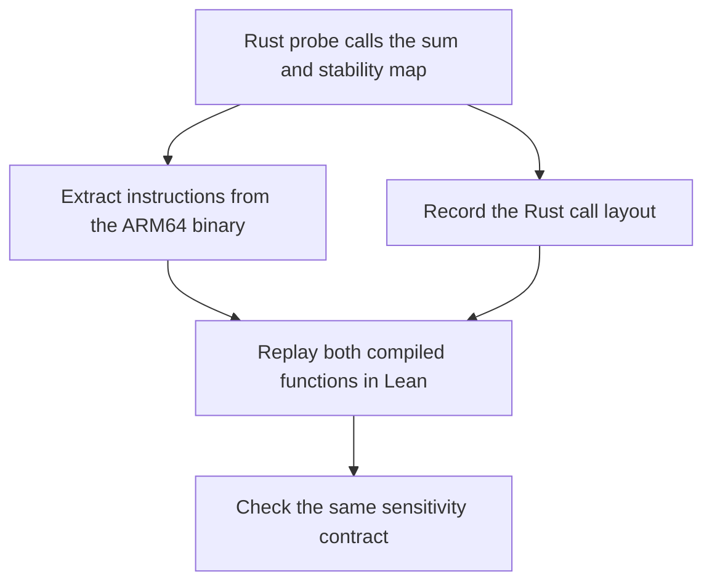

# OpenDP bounded sum

The old OpenDP implementation could underestimate how much a sum changes when one value is replaced. With the two-record datasets `[0, 0]` and `[0, 3]`, the sum changes by 3. The buggy forward map advertises 2 for the input distance of 2. The fixed map advertises 3. [Fix commit](https://github.com/opendp/opendp/commit/a64feeeb31de22ae9b4bdb20097d437cf93e044e)

The input domain has two integer records in `0..3` and distance budgets in `0..4`. The spec requires successful calls and a reported bound that covers the absolute change in sums whenever the multiset distance is within the budget. [Input types](Inputs.lean) · [Lean spec](Spec.lean)

The case manifest maps candidate A to the fix and candidate B to the old build. It records the original source revisions and hashes of the binaries and checked-in files. The instruction snapshot also records the observed Rust layout. [Case manifest](provenance.json) · [Instruction snapshot](fixtures/ClosureBytes.lean)

The agent receives the common spec and the selected build's machine definitions and disassembly. With `--arm-replay` it can ask for output tables backed by equalities checked in Lean. [Run the agent](../../README.md#run-the-agent-on-openrouter) · [Native rebuild and reference proofs](native/README.md)
