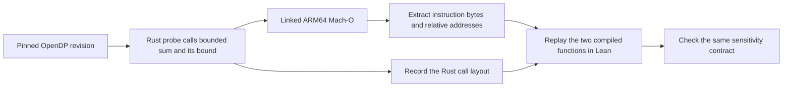

# OpenDP bounded sum

The old OpenDP implementation could underestimate how much a sum changes when one value is replaced. With the two-record datasets `[0, 0]` and `[0, 3]`, the sum changes by 3. The buggy forward map advertises 2 for the input distance of 2. The fixed map advertises 3. [Fix commit](https://github.com/opendp/opendp/commit/a64feeeb31de22ae9b4bdb20097d437cf93e044e)

[Inputs.lean](Inputs.lean) fixes the domain to two integer records in `0..3` and distance budgets in `0..4`. [Spec.lean](Spec.lean) requires the compiled functions to return successfully and the reported bound to cover the absolute change in sums whenever the multiset distance is within the budget.

[fixtures/ClosureBytes.lean](fixtures/ClosureBytes.lean) contains the extracted bytes and observed layout. [provenance.json](provenance.json) records the source revisions and hashes of the original binaries and checked-in files. Candidate labels follow the original binary hashes. A is the fix and B is the buggy build.

See the [native rebuild](native/README.md) for the probe, byte extractor, and manual Lean reference. The agent receives the common contract and only the selected candidate's machine definitions, disassembly, and replay interface.
