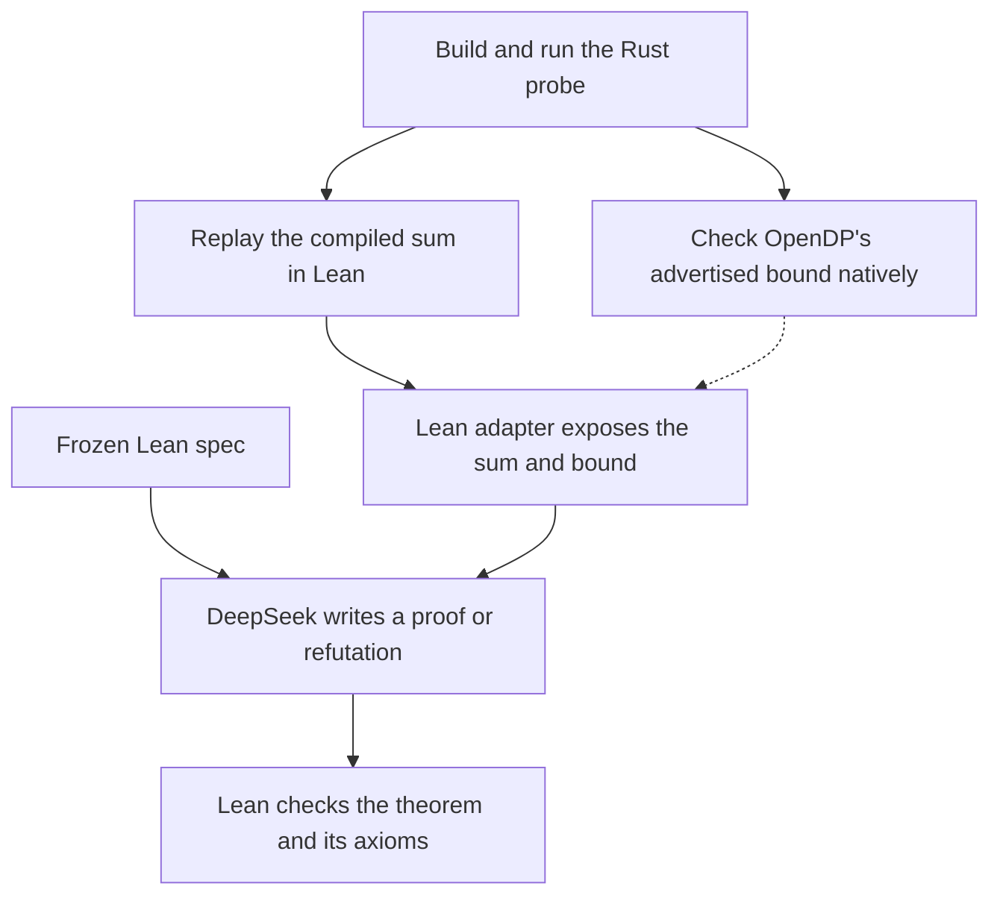

# OpenDP integer overflow

This case checks the unsized `make_bounded_sum::<i32>` before and after OpenDP's overflow fix. It uses four small datasets near the `i32` limit. In the old build, summing `[2^30, 2^30 - 1, 1]` wraps to `i32::MIN`; the fixed build saturates at `i32::MAX`.

| Dataset | Old build | Fixed build |
| --- | ---: | ---: |
| `[2^30 - 1]` | 1,073,741,823 | 1,073,741,823 |
| `[2^30, 2^30 - 1]` | 2,147,483,647 | 2,147,483,647 |
| `[2^30, 2^30 - 1, 1]` | -2,147,483,648 | 2,147,483,647 |
| `[2^30, 2^30 - 1, 0]` | 2,147,483,647 | 2,147,483,647 |

Adding `1` to `[2^30, 2^30 - 1]` changes the old build's result by 4,294,967,295, above its advertised bound of `2^30`. The Lean spec checks all pairs in the table whose distance is zero or one insertion or removal. [Frozen Lean spec](evidence/deepseek-v4.1-flash-1017/Spec.lean)



## Recorded result

DeepSeek V4.1 Flash 1017 produced both theorems on the first attempt using the same spec. Lean checked each theorem with only `propext` and `Quot.sound` in its axiom list.

| Candidate | Lean verdict | Lean check | Model tokens |
| --- | --- | ---: | ---: |
| A · Fixed revision | Proved | 8.36 s | 20,896 |
| B · Old revision | Refuted | 21.91 s | 9,093 |

Both candidate folders include the prompts, responses, model events, Lean files, and checker logs. The archived copy normalizes local filesystem paths. [Report](evidence/deepseek-v4.1-flash-1017/report.json) · [Run settings](evidence/deepseek-v4.1-flash-1017/experiment.json) · [Candidate A](evidence/deepseek-v4.1-flash-1017/A/) · [Candidate B](evidence/deepseek-v4.1-flash-1017/B/)

## Run the agent

Set up the toolchain and load your OpenRouter key. Run this command from the repository root. It uses the checked-in instruction snapshots and the exact spec from the recorded run. [Setup](../../README.md#set-up-and-run-offline) · [API key](../../README.md#run-the-agent-on-openrouter)

```sh
uv run --locked python -m dpverify --case opendp-overflow --attempts 2 --max-tokens 32768 verify \
  cases/opendp-overflow/evidence/deepseek-v4.1-flash-1017 \
  --approve-spec e0f2f02a87297c05a65faa6633c72fbe9b5d33b9bb3e5c030e221ab6799f7f43 \
  --proof-model deepseek/deepseek-v4.1-flash-1017 --lean-profile --out runs/overflow-result
```

The harness runs both candidates and saves the new traces under `runs/overflow-result/`. Pick a fresh output directory for each run. [How to read the output](../../README.md#read-a-run)

## Rebuild the Rust binaries

Use Rust 1.94.1, Python 3, and the Xcode Command Line Tools on an Apple Silicon Mac. Run this command from the repository root.

```sh
cases/opendp-overflow/native/run.sh
```

The script fetches the pinned OpenDP revisions, compiles both probes, and saves the binaries and native logs under `native/build/`. It rewrites the tracked instruction bytes and disassemblies under `fixtures/`. Use a separate checkout when comparing a local rebuild with the recorded snapshots. [Build script](native/run.sh) · [Original revisions and hashes](provenance.json)

## Scope

Lean executes the compiled sum using the recorded Rust `Vec<i32>` layout. The native probe calls the stability map at distances zero and one, checking for `0` and `2^30`. The Lean adapter uses those two values as the bound for the finite sensitivity claim. [ARM replay](ReplayCore.lean) · [Bound used in Lean](Machine.lean) · [Native probe](native/probe.rs)
