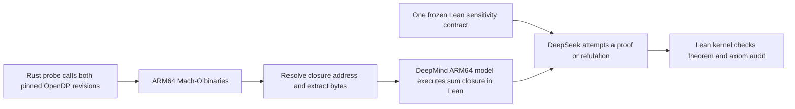

# OpenDP integer overflow

This case checks the unsized `make_bounded_sum::<i32>` before and after OpenDP's overflow fix. It uses four small datasets near the `i32` limit. In the old build, summing `[2^30, 2^30 - 1, 1]` wraps to `i32::MIN`; the fixed build saturates at `i32::MAX`.

| Dataset | Old build | Fixed build |
| --- | ---: | ---: |
| `[2^30 - 1]` | 1,073,741,823 | 1,073,741,823 |
| `[2^30, 2^30 - 1]` | 2,147,483,647 | 2,147,483,647 |
| `[2^30, 2^30 - 1, 1]` | -2,147,483,648 | 2,147,483,647 |
| `[2^30, 2^30 - 1, 0]` | 2,147,483,647 | 2,147,483,647 |

The frozen Lean contract checks every ordered pair in this domain at insertion distance zero or one. It requires successful sums and a change no larger than `2^30` for neighboring datasets. The native probe also calls OpenDP's stability map at distances zero and one and checks the returned bounds `0` and `2^30`.



## Rebuild and run

On an Apple Silicon Mac, install Rust 1.94.1, Xcode Command Line Tools, Python 3, `uv`, Lean 4.34.0, and the pinned ARM64 model as described in the [main README](../../README.md). Build both native versions and extract the sum closures:

```sh
OPENDP_PILOT_CACHE="$PWD/.cache/install-test" cases/opendp-overflow/native/run.sh
```

The script downloads the two pinned OpenDP revisions when needed, compiles both probes, verifies their outputs and bounds, and saves their binaries and build logs under the ignored `native/build/` directory. `fixtures/ClosureBytes.lean` and the two disassemblies are checked in with hashes in `provenance.json`.

Copy the case spec and its checked declarations into a run directory, review it, then use its SHA-256 in the proof command:

```sh
mkdir -p runs/overflow-spec
cp cases/opendp-overflow/Inputs.lean runs/overflow-spec/Inputs.lean
cat cases/opendp-overflow/Spec.lean cases/opendp-overflow/SpecChecks.lean > runs/overflow-spec/Spec.lean
shasum -a 256 runs/overflow-spec/Spec.lean
uv run --locked python -m dpverify --case opendp-overflow --attempts 2 --max-tokens 32768 verify \
  runs/overflow-spec --approve-spec <reviewed-sha256> --proof-model deepseek/deepseek-v4.1-flash-1017 \
  --out runs/overflow-result
```

The harness checks both candidates with the same spec and model. Candidate A is the fixed revision; candidate B is the old revision. Their full prompts, model responses, streamed events, token usage, Lean files, and Lean logs are saved under `runs/overflow-result/`.

## Scope

The proof target is the compiled sum closure. Lean replays its extracted ARM64 instructions using the recorded Rust `Vec<i32>` layout. The probe executes the stability map natively and checks its values at distances zero and one; this case does not separately replay that map's machine instructions. It checks a finite sensitivity contract, not OpenDP's noise mechanism or an end-to-end differential privacy guarantee.

## First live run

On 2026-11-11, `deepseek/deepseek-v4.1-flash-1017` handled both candidates against spec SHA-256 `e0f2f02a87297c05a65faa6633c72fbe9b5d33b9bb3e5c030e221ab6799f7f43`. It proved A (the fix) and refuted B (the old build) on the first attempt. Lean took 8.36 seconds for the proof and 21.91 seconds for the refutation; both verdicts use only `propext` and `Quot.sound`.

The model used 20,896 tokens for A and 9,093 for B. The [run report](evidence/deepseek-v4.1-flash-1017/report.json) and [settings](evidence/deepseek-v4.1-flash-1017/experiment.json) accompany the full prompts, responses, streamed notifications, session events, usage, proof files, and Lean logs under `evidence/deepseek-v4.1-flash-1017/A/` and `B/`. The raw, unmodified run is also in the ignored local directory `runs/overflow-deepseek-1017/`; the checked-in copy normalizes the machine-specific repository path.
