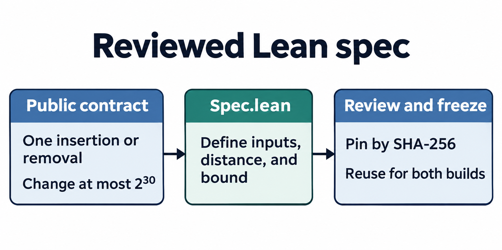
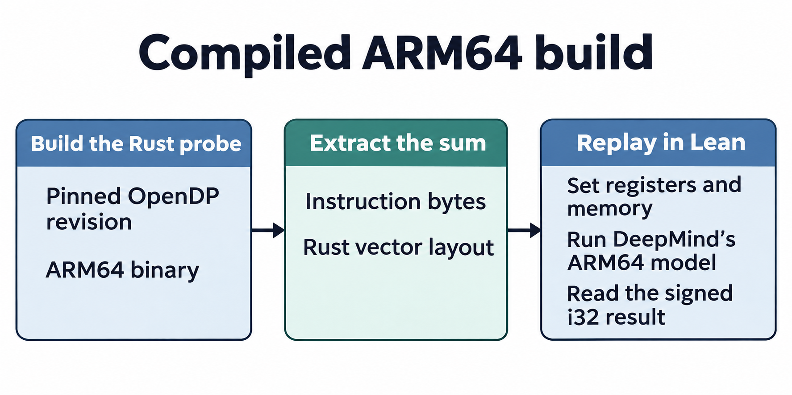
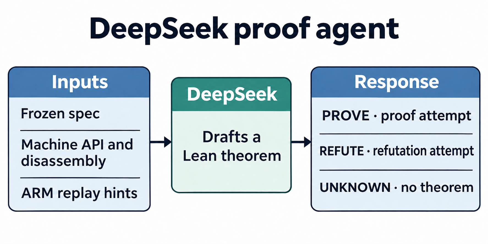
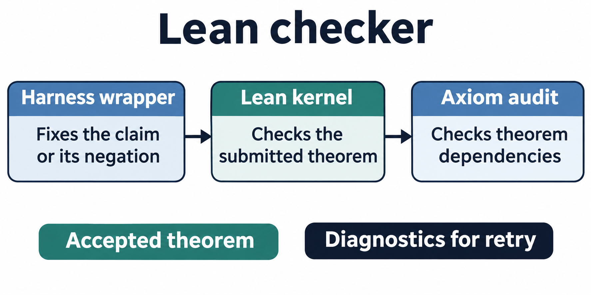
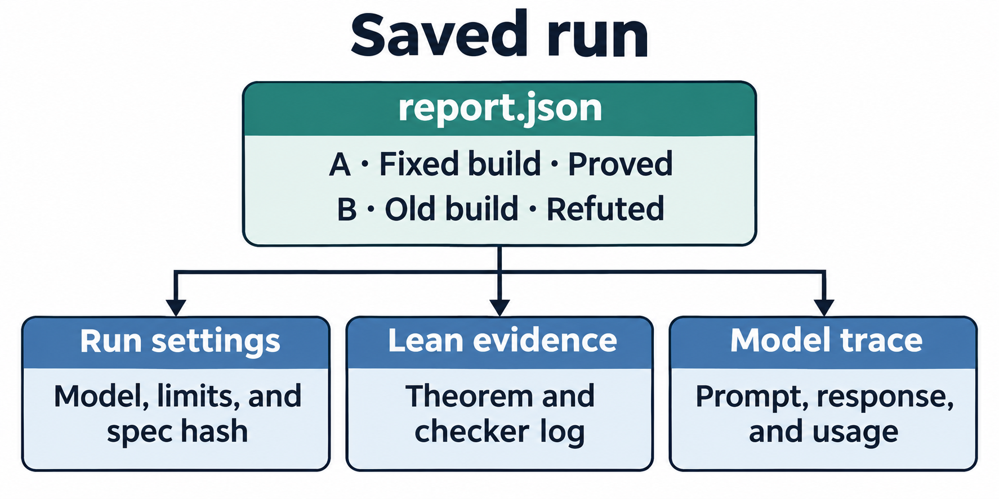

# Inside the verification protocol

This walkthrough follows the OpenDP overflow experiment. Candidate A is the fixed build and candidate B is the old build. The harness checks both against one reviewed sensitivity claim. [Protocol overview](../README.md#how-it-works) · [Overflow case](../cases/opendp-overflow/README.md)

## Reviewed Lean spec

The contract covers four input datasets. For each pair within the specified distance, both sum calls and the bound must return successfully, and the bound must cover the absolute difference between sums. For one insertion or removal, the overflow case uses a bound of `2^30`. The harness verifies the SHA-256 of the reviewed `Spec.lean` before checking either build. [Frozen spec](../cases/opendp-overflow/evidence/deepseek-v4.1-flash-1017/Spec.lean)

## Compiled ARM64 build

The native probe identifies the compiled sum closure and records the layout of Rust's `Vec<i32>`. The extractor saves the instruction bytes. The Lean adapter places the input in modeled memory, initializes the registers, and uses DeepMind's ARM64 model to step through the bytes until the function returns. It reads the result as a signed `i32`. The native probe separately checks the bound used by this case at distances zero and one. [Extractor](../cases/opendp-overflow/native/extract.py) · [ARM replay](../cases/opendp-overflow/ReplayCore.lean) · [Native probe](../cases/opendp-overflow/native/probe.rs)

## DeepSeek proof agent

For each candidate, the harness sends the reviewed spec, the Lean machine interface, the disassembly, and replay hints. In the old build, appending `1` to `[2^30, 2^30 - 1]` changes the result from `i32::MAX` to `i32::MIN`. DeepSeek uses that pair in a proposed refutation. The absolute change is `4,294,967,295`, above the bound of `2^30`. [Old build prompt](../cases/opendp-overflow/evidence/deepseek-v4.1-flash-1017/B/proof-1/prompt.txt) · [Model response](../cases/opendp-overflow/evidence/deepseek-v4.1-flash-1017/B/proof-1/response.txt)

## Lean checker

The harness wraps the submission in `HarnessVerdict`, whose type is the exact sensitivity claim for `PROVE` and its negation for `REFUTE`. It runs Lean and checks the axiom list against the allowed set. A failed check sends diagnostics back to the agent if another attempt is available. The recorded proof and refutation both passed with `propext` and `Quot.sound` as their only axiom dependencies. [Old build theorem](../cases/opendp-overflow/evidence/deepseek-v4.1-flash-1017/B/Attempt1.lean) · [Lean log](../cases/opendp-overflow/evidence/deepseek-v4.1-flash-1017/B/Attempt1.lean.log)

## Saved run

`report.json` gives each verdict and records the check time for accepted theorems. `experiment.json` records the model, limits, and spec hash. The recorded candidate folders contain the submitted Lean files and checker logs. Their attempt folders preserve the model prompts, responses, events, and token usage. [Verdicts](../cases/opendp-overflow/evidence/deepseek-v4.1-flash-1017/report.json) · [Settings](../cases/opendp-overflow/evidence/deepseek-v4.1-flash-1017/experiment.json) · [Model usage](../cases/opendp-overflow/evidence/deepseek-v4.1-flash-1017/B/proof-1/model.json)

[Image generation prompts](figures/protocol/prompts.txt)
